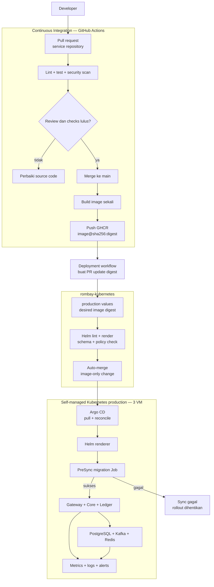
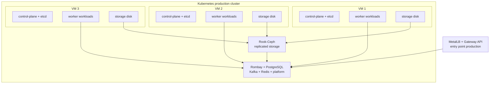
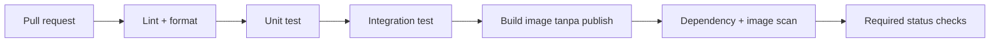
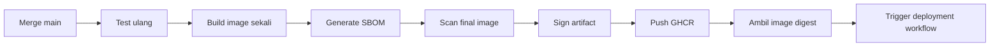
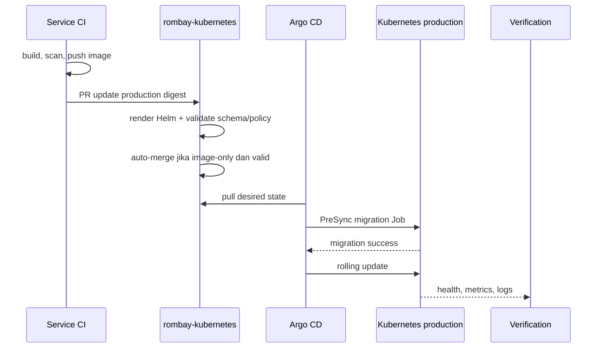

# Arsitektur Pipeline Rombay Kubernetes

Dokumen ini menjelaskan CI/CD Rombay untuk satu environment production pada self-managed Kubernetes yang terdiri dari tiga VM. Tidak ada environment development atau staging permanen.

Keputusan utama:

- Tiga VM membentuk satu cluster Kubernetes production.
- Setiap VM berperan sebagai control-plane sekaligus worker agar tidak membutuhkan VM tambahan.
- Seluruh runtime Rombay, PostgreSQL, Kafka, Redis, storage, observability, dan delivery controller berjalan di Kubernetes.
- Pull request source code menjadi approval manusia sebelum release.
- Setelah source code di-merge, build dan deployment ke production berjalan otomatis.
- Repo `rombay-kubernetes` menjadi source of truth desired state production.
- Helm hanya merender manifest; Argo CD menarik dan menerapkannya ke cluster.
- Image dibangun sekali dan selalu dipasang berdasarkan digest immutable.

GitHub dan GHCR tetap menjadi layanan source control, CI control plane, dan container registry. Workload runtime tidak bergantung pada managed Kubernetes, managed database, managed Kafka, atau managed Redis.

## 1. Arsitektur tingkat tinggi



Tidak ada promotion service. Kotak `Deployment workflow` adalah GitHub Actions job yang memakai GitHub App untuk membuat pull request lintas repository.

## 2. Topologi cluster tiga VM



Scheduler harus menyebarkan replica service dan komponen quorum ke VM berbeda menggunakan topology spread, pod anti-affinity, serta `PodDisruptionBudget`.

Ketiga VM harus memiliki kapasitas tersisa yang cukup agar workload kritis tetap berjalan ketika satu VM tidak tersedia. Jumlah replica tidak otomatis menjamin high availability jika dua VM yang tersisa tidak mampu menampung pod hasil rescheduling.

## 3. Pembagian tanggung jawab repository

| Repository | Tanggung jawab |
|---|---|
| `rombay-gateway` | Source Go, test, Dockerfile, dan build image Gateway |
| `rombay-core` | Source Spring Boot, test, migrasi database, dan build image Core |
| `rombay-ledger` | Source Rust, test, migrasi database, dan build image Ledger |
| `rombay-kubernetes` | Helm chart, production values, Argo CD Application, platform operator, policy, serta konfigurasi cluster |

Source repository tidak menyimpan kubeconfig production. Repo Kubernetes tidak membangun ulang image aplikasi.

## 4. Struktur repository

```text
rombay-kubernetes/
├── bootstrap/
│   ├── argocd/
│   └── root-application.yaml
├── cluster/
│   └── production/
├── platform/
│   ├── networking/
│   ├── certificates/
│   ├── storage/
│   ├── cloudnative-pg/
│   ├── strimzi/
│   ├── redis/
│   ├── observability/
│   └── backup/
├── charts/
│   ├── rombay-gateway/
│   ├── rombay-core/
│   └── rombay-ledger/
├── environments/
│   └── production/
│       ├── gateway-values.yaml
│       ├── core-values.yaml
│       └── ledger-values.yaml
├── policies/
├── scripts/
└── docs/
```

Chart per service tidak mengubah service menjadi aplikasi Helm. Chart hanya mengemas resource Kubernetes milik service tersebut, seperti `Deployment`, `Service`, `HorizontalPodAutoscaler`, `PodDisruptionBudget`, dan `NetworkPolicy`.

Platform stateful dikelola melalui operator dan custom resource:

- CloudNativePG mengelola PostgreSQL Core dan PostgreSQL Ledger secara terpisah.
- Strimzi mengelola Kafka, topic, user, dan credential terkait.
- Redis berjalan dalam mode high availability melalui operator atau chart yang dipilih.
- Rook-Ceph menyediakan persistent volume dan object storage.

## 5. Continuous Integration service

Setiap service memiliki dua workflow utama.

### Pull request



Pull request source code adalah control gate manusia. Pull request tidak mem-push image release dan tidak melakukan deployment.

### Merge ke main



Manifest selalu menggunakan digest:

```text
ghcr.io/rombay-tbk/rombay-core@sha256:0123456789abcdef...
```

Tag boleh ditambahkan untuk keterbacaan, tetapi tidak menjadi identitas artifact yang dipasang ke production.

## 6. Continuous Delivery langsung ke production

Setelah image berhasil diterbitkan, deployment workflow membuka pull request ke repo `rombay-kubernetes`.

Contoh perubahan:

```diff
 image:
   repository: ghcr.io/rombay-tbk/rombay-core
-  digest: sha256:old
+  digest: sha256:new
```

Alur lengkap:



Pull request deployment tidak menunggu reviewer manusia jika seluruh kondisi berikut terpenuhi:

- hanya field image digest service yang berubah;
- digest berasal dari GHCR organisasi `rombay-tbk`;
- CI source commit sudah lulus dan di-merge;
- Helm lint dan render berhasil;
- manifest lolos schema serta policy validation;
- tidak ada secret plaintext;
- branch protection required checks lulus.

GitHub App hanya memiliki akses minimum untuk membuat branch, mengubah file production values yang diizinkan, dan membuka pull request. App tidak diberi akses administrator cluster.

## 7. Perubahan yang tidak boleh auto-merge

Perubahan berikut tetap memerlukan review manusia:

- upgrade Kubernetes, Argo CD, operator, atau CRD;
- perubahan PostgreSQL, Kafka, Redis, Rook-Ceph, dan storage;
- perubahan resource request/limit besar;
- perubahan replica, autoscaling, PDB, atau topology policy;
- perubahan network policy, RBAC, secret management, dan admission policy;
- perubahan database migration strategy;
- perubahan Gateway API, TLS, DNS, dan jalur trafik production.

Dengan pemisahan ini, automation image release tidak dapat dipakai untuk menyisipkan perubahan platform.

## 8. Argo CD dan Helm

Argo CD menjadi satu-satunya komponen yang menerapkan desired state ke cluster. Argo CD `Application` menunjuk ke:

- chart service;
- production values;
- branch `main` repo `rombay-kubernetes`;
- cluster dan namespace production;
- automated sync dan self-heal policy.

```text
charts/rombay-core/
        +
environments/production/core-values.yaml
        ↓
Argo CD render dengan Helm
        ↓
Deployment + Service + HPA + PDB + NetworkPolicy
```

Pipeline tidak menjalankan `kubectl apply` atau `helm upgrade` ke production. Credential cluster hanya dimiliki komponen delivery di dalam cluster dan operator yang berwenang.

`prune` harus diaktifkan secara hati-hati. Penghapusan namespace, persistent volume, database, Kafka, Redis, dan storage tidak boleh terjadi hanya karena auto-merge image release.

## 9. Migrasi database

Core dan Ledger menjalankan migrasi melalui Argo CD `PreSync` Job:

```text
desired image digest berubah
    ↓
jalankan migration Job
    ↓
migration berhasil?
    ├── tidak → sync gagal dan rollout berhenti
    └── ya → rolling update Deployment
```

Ketentuan migrasi:

- Migration Job memakai digest image yang sama dengan aplikasi.
- Runtime database user tidak memiliki hak DDL.
- Migrasi harus backward-compatible dengan pod versi sebelumnya.
- Kegagalan migrasi menghentikan rollout.
- Rollback aplikasi tidak dianggap sebagai rollback database.
- Perubahan destruktif menggunakan pola expand-and-contract dalam release terpisah.

## 10. Strategi rollout

Baseline menggunakan Kubernetes `RollingUpdate`:

- Gateway dan Core memiliki minimal dua replica jika kapasitas memungkinkan.
- `maxUnavailable: 0` dipakai jika cluster memiliki ruang untuk pod tambahan saat rollout.
- Readiness probe mencegah pod menerima trafik sebelum siap.
- Startup probe memberi waktu startup untuk service yang lambat.
- Liveness probe hanya mendeteksi proses yang benar-benar macet.
- Pod replica disebarkan ke VM berbeda.
- `PodDisruptionBudget` menjaga replica tersedia saat node drain terencana.

Canary deployment dan rollback otomatis dengan Argo Rollouts dapat ditambahkan setelah metrics dan threshold production sudah stabil. Baseline awal tidak menganggap canary sebagai syarat deployment.

## 11. Verifikasi deployment

Release dianggap berhasil hanya jika:

- Argo CD menunjukkan `Synced` dan `Healthy`;
- migration Job selesai jika terdapat migrasi;
- Deployment mencapai jumlah replica tersedia yang diinginkan;
- readiness probe seluruh pod lulus;
- smoke test endpoint production lulus;
- Kafka consumer lag tidak tumbuh abnormal;
- error rate, latency, outbox backlog, dan webhook retry berada dalam batas;
- node, storage, PostgreSQL, Kafka, dan Redis tetap sehat.

Status `Synced` saja tidak cukup karena manifest dapat sesuai Git ketika aplikasi masih belum sehat.

## 12. Kegagalan dan rollback

Jika migration Job atau readiness gagal, Argo CD menandai aplikasi `Degraded` dan rollout tidak dianggap selesai. Alert harus dikirim ke operator.

Rollback baseline dilakukan dengan Git revert:

```text
deployment bermasalah
    ↓
revert commit digest di rombay-kubernetes
    ↓
merge emergency change
    ↓
Argo CD menyinkronkan digest sebelumnya
    ↓
verifikasi health dan metrics
```

Jangan menjalankan `helm rollback` manual untuk resource yang dikelola Argo CD karena hasilnya berbeda dari desired state Git dan dapat dikembalikan oleh self-heal.

Automatic rollback baru diaktifkan setelah sinyal kesehatan dapat dipercaya. Rollback yang salah berdasarkan alert yang noisy dapat memperpanjang insiden.

## 13. Pipeline platform

Komponen platform tidak mengikuti auto-merge image aplikasi. Versi operator dan chart platform diperbarui melalui pull request dengan review manusia.

Urutan bootstrap:

```text
1. kubeadm pada tiga VM
2. control-plane endpoint dan CNI
3. Rook-Ceph serta storage dasar
4. install Argo CD satu kali
5. apply root Application
6. Argo CD mengelola platform dan aplikasi
```

Urutan rekonsiliasi platform:

```text
1. CRD dan operator
2. networking, certificate, dan storage
3. PostgreSQL, Kafka, dan Redis custom resources
4. observability dan backup
5. Gateway, Core, dan Ledger
```

Karena tidak ada staging, upgrade platform wajib memiliki backup tervalidasi, compatibility check, maintenance window, serta rencana rollback sebelum merge.

## 14. Keamanan supply chain

- Workflow menggunakan permission GitHub minimum dan eksplisit.
- GitHub App digunakan untuk akses lintas repository; hindari personal access token jangka panjang.
- Token GitHub App dibatasi ke repo `rombay-kubernetes` dan berumur pendek.
- Image menghasilkan SBOM, dipindai, dan ditandatangani sebelum deployment.
- Admission policy dapat menolak image yang tidak berasal dari registry atau signer yang diizinkan.
- Secret tidak disimpan di Helm values atau Git plaintext.
- Argo CD memakai credential read-only ke Git jika tidak memerlukan write access.
- Hak sync manual, override, dan akses production dibatasi melalui RBAC dan diaudit.
- Bot image update tidak boleh mengubah chart, platform, policy, atau secret reference.

## 15. Branch dan review policy

Branch `main` menjadi desired state yang dibaca Argo CD.

Policy untuk update image otomatis:

- pull request wajib dibuat oleh GitHub App yang diizinkan;
- hanya file digest service terkait yang boleh berubah;
- seluruh required checks wajib lulus;
- auto-merge diizinkan tanpa reviewer manusia;
- force push dan branch deletion dinonaktifkan.

Policy untuk platform dan konfigurasi manual:

- pull request wajib;
- CODEOWNERS review wajib;
- perubahan database, Kafka, storage, RBAC, network, dan production policy memerlukan approval manusia;
- force push dan bypass oleh user biasa dinonaktifkan.

## 16. Workflow yang dibutuhkan

| Repository | Workflow | Trigger | Output |
|---|---|---|---|
| Service | `ci.yml` | Pull request | Lint, test, scan, dan required checks |
| Service | `release-image.yml` | Merge ke `main` | Image digest, SBOM, dan signature |
| Service | `deploy-production.yml` | Image release sukses | PR image-only ke `rombay-kubernetes` |
| Kubernetes | `validate.yml` | Pull request | Helm render, schema, policy, dan change-scope check |
| Kubernetes | `auto-merge-image.yml` | Checks image-only lulus | Merge desired digest production |

Argo CD menangani deployment setelah merge, sehingga workflow GitHub tidak membutuhkan kubeconfig production.

## 17. Risiko yang diterima

Desain satu cluster dan satu environment menyederhanakan biaya serta pipeline, tetapi menerima risiko berikut:

- tidak ada validasi pada environment yang menyerupai production sebelum deployment;
- bug yang lolos CI langsung mencapai production;
- upgrade platform pertama kali diuji pada cluster production;
- seluruh aplikasi dan data berbagi failure domain tiga VM;
- kehilangan cluster atau storage domain dapat menghentikan seluruh Rombay;
- backup di cluster yang sama bukan perlindungan terhadap kehilangan seluruh cluster.

Risiko dikurangi melalui integration test dengan dependency sementara di CI, manifest validation, immutable image, rolling update, readiness probe, observability, backup, dan Git-based rollback. Backup yang mampu menghadapi kehilangan seluruh cluster tetap membutuhkan salinan pada failure domain lain.

## 18. Keputusan lanjutan

Hal berikut perlu difinalkan sebelum pipeline diimplementasikan:

- GitHub-hosted runner atau Actions Runner Controller di cluster.
- GitHub App serta aturan path yang diizinkan untuk update digest.
- Scanner, signer, SBOM format, dan admission policy.
- Implementasi Gateway API, CNI, MetalLB, dan certificate management.
- Kapasitas CPU, memori, dan disk masing-masing VM.
- Target replica serta resource request/limit tiap komponen.
- Health threshold, alert routing, dan smoke test production.
- Lokasi backup di luar failure domain cluster production.
